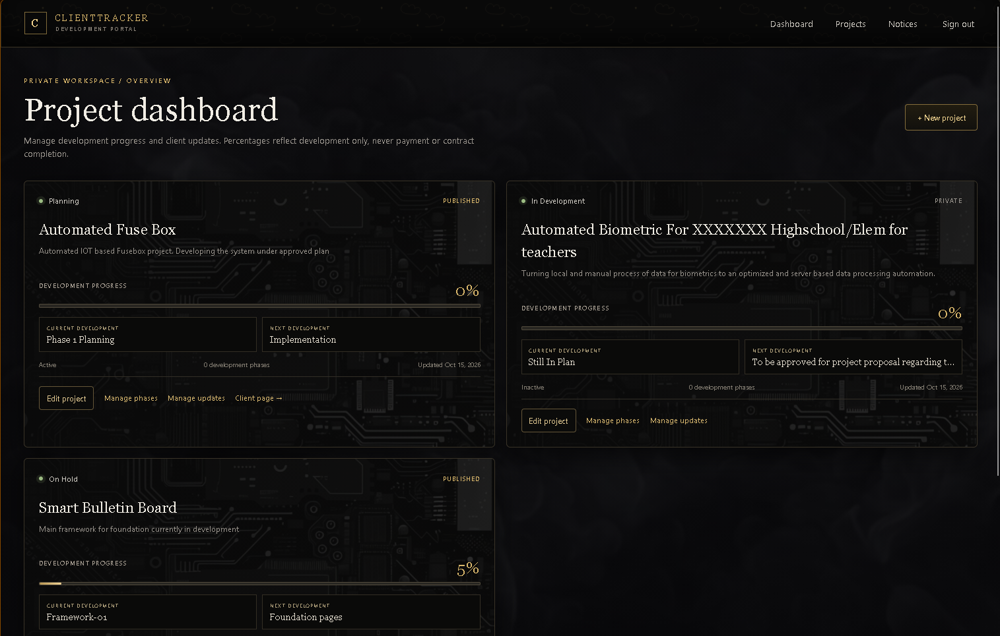
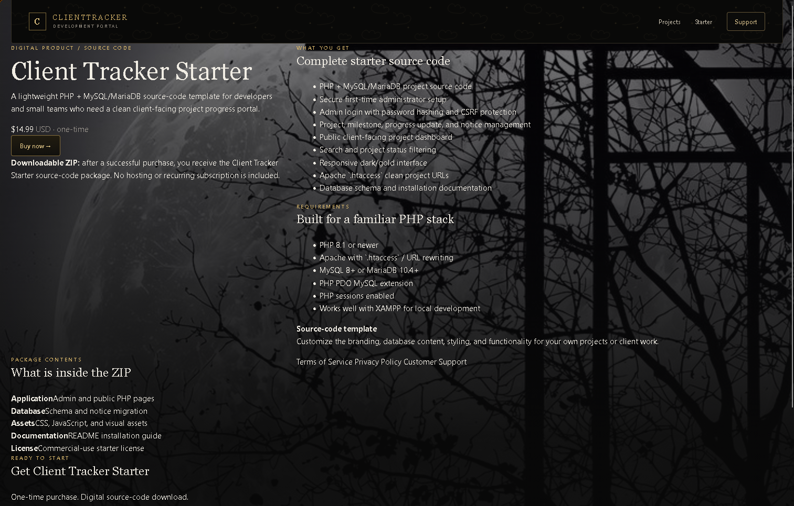
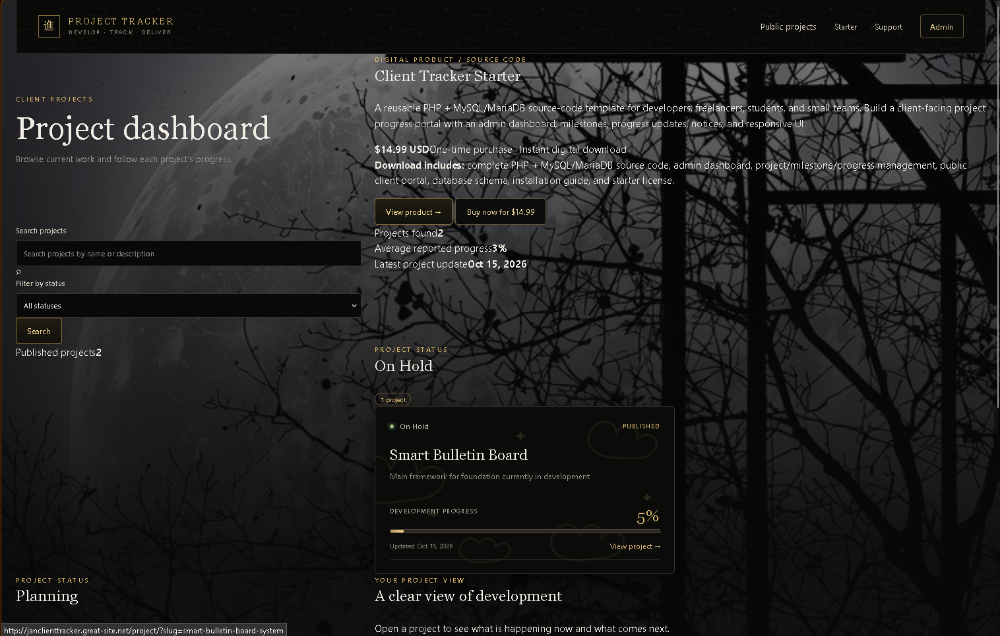
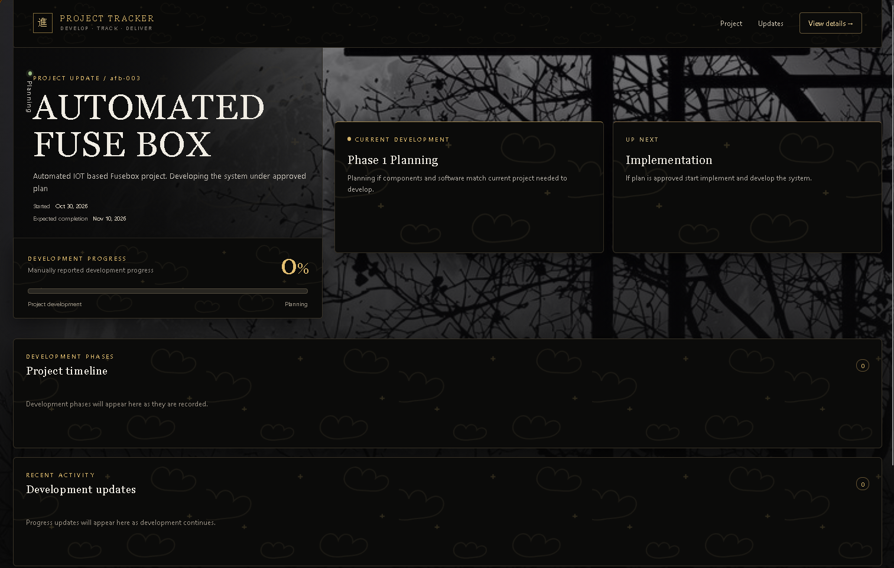

# Client Tracker Starter

A lightweight PHP & MySQL project tracking system for freelancers, developers, students, and small teams.

Client Tracker helps you organize projects, monitor development progress, manage milestones, and provide clients with a clean public project page.

## Features

- Project management dashboard
- Client/project information
- Development progress tracking
- Project phases and milestones
- Development updates
- Public project pages
- Client-facing notices
- Search and project filtering
- Responsive interface
- PHP + MySQL database
- Easy local XAMPP installation
- Customizable starter system

## Screenshots

### Admin Dashboard

### Project Preview

### Public Dashboard

### Sample Project

## Technology

- PHP
- MySQL / MariaDB
- HTML5
- CSS3
- JavaScript
- Bootstrap
- XAMPP

## Who Is It For?

Client Tracker Starter is designed for:

- Freelancers
- Web developers
- Students
- Small development teams
- Agencies
- Anyone who needs a simple project tracking system

## Requirements

- PHP 8.x
- MySQL or MariaDB
- Apache
- XAMPP or another compatible PHP environment

## Installation

1. Download the Client Tracker Starter package.
2. Extract the project into your web server directory.
3. Create the database.
4. Import the provided database schema.
5. Configure the database connection.
6. Start Apache and MySQL.
7. Open the application in your browser.
8. Create your administrator account.

Detailed installation instructions are included with the purchased package.

## Important

This repository contains product information and demonstration screenshots.

The complete source code and installation package are provided separately to customers after purchase.

## Purchase

Get the complete Client Tracker Starter package from the official product store:

**[Purchase Client Tracker Starter](YOUR-CREAM-PRODUCT-LINK)**

## License

This project is a commercial starter product.

The license and usage terms are provided with the purchased package.
